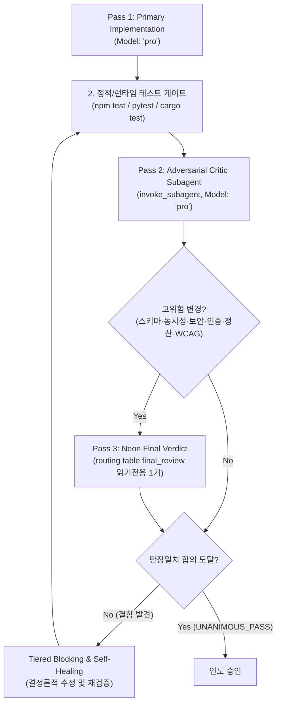

# Dual-Verify: 2-Pass Real-Time Co-Verification

코드 구현 직후 1차 구현 결과물을 바탕으로, 독립된 적대적 감사 서브에이전트가 3대 핵심 영역(① 보안/인젝션, ② 동시성/비동기 레이스, ③ 경계 계약/타입 안전성)을 집중 감사하여 만장일치(Unanimous Pass) 합의에 도달했을 때만 완료를 승인하는 2-Pass 품질 보증 프로토콜이다. 고위험 변경에는 **Pass 3(독립 최종 판정)**이 기본으로 붙는다.



---

## 2-Pass Verification Protocol

### Pass 1: Primary Implementation (`Model: "pro"`)
핵심 비즈니스 로직과 단위 테스트를 작성하고 기본 테스트 스위트를 통과시킨다. `≤200줄(<18KB)`은 원샷 작성하고 200줄 초과 시에만 100줄 이하 청크로 분할하며 쓴 파일은 완료 전 다시 연다.

### Pass 2: Adversarial Critic (`invoke_subagent`, `Model: "pro"`)
독립된 서브에이전트가 코드의 잠재적 취약점을 공격적으로 감사한다. 감사 결과의 모든 항목은 `파일:라인`과 함께 돌아와야 하며, 근거 라인을 열어 보지 않은 판정은 무효다(코드베이스 "설명" 환각 방지).

```javascript
invoke_subagent({
  TypeName: "self",
  Role: "Adversarial Code Critic",
  Model: "pro",
  Prompt: """목표: 변경된 코드에 대한 3대 영역 적대적 감사를 수행하라.
완료 조건: 아래 3대 영역의 결함 유무를 파일:라인 근거와 함께 판정(UNANIMOUS_PASS 또는 BLOCKING)하라. 근거 라인은 반드시 직접 열어 인용한다.
범위:
1. Security: SQLi, command injection, path traversal, untrusted inputs.
2. Concurrency: unawaited promises, race conditions, lock deadlocks.
3. Boundary: exhaustive matches, no 'as any', null safety.
종료 조건: 같은 도구 호출 3회 반복 / 도구 호출 40회 초과 → UNKNOWN 반환
반환 형식: ≤40줄, 판정·근거·재현 명령만"""
})
```

### Pass 3: Neon Final Verdict (고위험 변경 기본)

적용 조건(하나라도 해당): DB 스키마·마이그레이션, 동시성 원시 연산, 인증·인가·암호, 결제·정산·재고 차감, WCAG 접근성 계약, 법원 최종 제출본, 공용 API 계약 변경.

모델 선택은 `model-routing.json`의 `final_review`(Neon high 기준선, 근거 있는 해당 게이트만 xhigh 승격)를 따른다. 호스트 tier 매핑은 [미확인]이며 요구 수준 확인 전 승인하지 않는다.

절차:
1. `invoke_subagent`의 `pro`를 요구 모델/사고 수준에 매핑할 수 있으면 읽기 전용 검증관을 호출한다.
2. 보안·동시성·경계조건·WCAG 결함을 파일:줄 근거로 보고받고 `BLOCKING`을 수정한 뒤 다시 검증한다.
3. 지원되는 워커 종료 API로 회수한다(`action: "kill"` 지원 여부 [미확인]).
4. 요구 모델을 호출할 수 없으면 `refuse: needs <required model>`로 보류하고 `.lazyneon/dual-verify-handoff.md`에 미검증 항목을 남긴다.

### Tiered Blocking & Self-Healing Policy
- `P0 (Critical Security)`: 즉각 블로킹 및 수정 후 재검증.
- `P1 (Concurrency Hazard)`: 비동기 레이스 수정 전까지 완료 선언 금지.
- `P2 (Type/Boundary Gap)`: 타입 및 경계 조건 즉시 보강.
- `P3 (Adoption Screen)`: 스테일 데이터 가정·비공개 내부 API 의존·범위 밖 수정·요청 대비 과대 변경은 테스트 통과와 무관하게 기각한다.
- `P4 (Blind Comparison & KEEP_BASE — harness2)`: 두 후보 구현이나 리팩토링 전후를 비교할 때는 "수정본/고도화본"이라는 라벨에 가산점을 주지 않고(익명 비교), 실행된 렌더링/출력 증거와 요청사항 대조만으로 판정한다. 변경이 관찰 가능한 개선을 입증하지 못하면 원본(`KEEP_BASE`)을 채택한다.

고위험·논쟁 항목만 초안과 분리한 중립 질문으로 원문 또는 재현 로그를 확인한다. 매 작업에 별도 호출을 강제하지 않는다.
