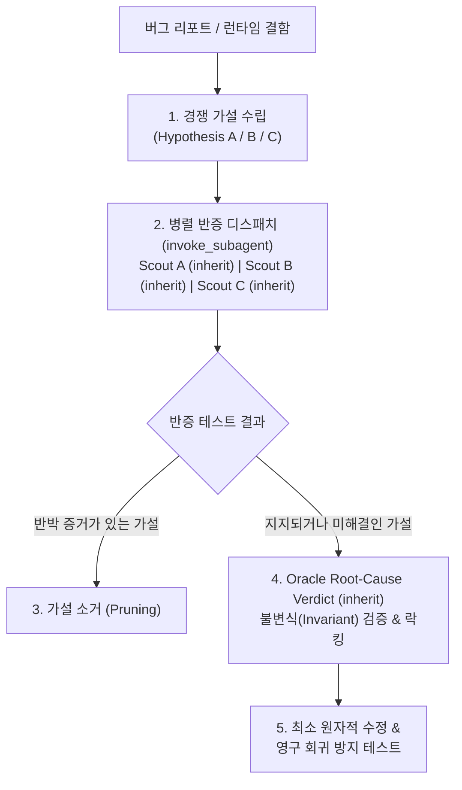

# Hypothesis-Tree: Parallel Falsification & Invariant Root-Cause Isolation

경쟁 가설과 재현 근거를 대조하여 복합 원인을 포함한 근본 원인 후보를 좁힙니다.



---

## 5-Step Hypothesis-Tree Workflow

### Step 1: Orthogonal Hypothesis Generation (경쟁 가설 수립)
관찰을 설명할 수 있는 경쟁 가설을 세운다. 아래 세 범주는 출발점이며 가설 수·상호 배타성·단일 원인을 강제하지 않는다. 가능성이 높은 가설부터 검증하되 낮은 가능성의 가설도 반박 근거 없이 폐기하지 않는다.
- **Hypothesis A (상태/데이터 경계)**: 입력 파라미터 변환, 직렬화/역직렬화, 널/미정의 상태 오염
- **Hypothesis B (동시성/타이밍/레이스)**: 비동기 실행 순서 꼬임, 이벤트 루프 지연, 락/트랜잭션 경쟁
- **Hypothesis C (환경/외부 의존성)**: 파일시스템 권한, 서드파티 API 계약 불일치, 런타임 환경 설정

### Step 2: Parallel Falsification Dispatch (병렬 반증)
가설별로 전제와 재현 조건을 명시해 독립 검증한다. 아래 A/B/C는 예시이며 가설 수나 병렬 실행을 강제하지 않는다.

```
invoke_subagent({
  TypeName: "self",
  Role: "Hypothesis A Falsifier",
  Model: "inherit",
  Prompt: """TASK: Probe and falsify Hypothesis A (State/Data Boundary mutation).
ACTION: Write and execute a deterministic failing test targeting Hypothesis A.
DELIVERABLE: reproduction test command and observable pass/fail receipt.
SCOPE: targeted data transformations."""
})
invoke_subagent({
  TypeName: "self",
  Role: "Hypothesis B Falsifier",
  Model: "inherit",
  Prompt: """TASK: Probe and falsify Hypothesis B (Concurrency/Race condition).
ACTION: Write a high-load or out-of-order reproduction script targeting Hypothesis B.
DELIVERABLE: concurrency trace and execution receipt.
SCOPE: async control flow."""
})
invoke_subagent({
  TypeName: "self",
  Role: "Hypothesis C Falsifier",
  Model: "inherit",
  Prompt: """TASK: Probe and falsify Hypothesis C (Environment/Contract mismatch).
ACTION: Inspect environment variables, OS permissions, and external payload contracts.
DELIVERABLE: environment audit receipt.
SCOPE: configuration and external boundaries."""
})
```

### Step 3: Falsification & Pruning (소거법 검증)
미재현은 반증이 아니다. 테스트가 가설의 전제와 필요한 조건을 실제로 충족했는지 확인하고, 반박 증거가 있는 가설만 기각한다. 나머지는 지지·반박·미해결로 구분하며 복합 원인 가능성을 유지한다.

### Step 4: Oracle Verdict & Invariant Lock (오라클 검증)
남은 가설을 원문·재현 로그·반례와 대조해 재검증한다. 유일한 생존 가설이라는 이유만으로 원인을 확정하지 않으며, 증거가 부족하면 미해결로 남긴다. 수정 후에는 해당 원인과 관찰된 실패를 연결하는 회귀 검증을 수행한다.

```
invoke_subagent({
  TypeName: "self",
  Role: "Root-Cause Oracle",
  Model: "inherit",
  Prompt: """TASK: Critically confirm the isolated root cause and verify that the proposed invariant test fully prevents regression.
DELIVERABLE: confirmation verdict and invariant test contract.
SCOPE: workspace defect boundary."""
})
```

### Step 5: Minimal Fix & Verification (최소 수정 & 종결)
식별된 근본 원인에 대한 최소한의 원자적 수정만 적용하고 테스트 통과를 검증합니다.
