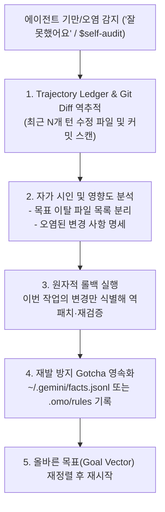

# Self-Audit: Agent Confession & Atomic Rollback Protocol

에이전트가 모델 스위칭(Session Drift), 컨텍스트 오염, 환각으로 인해 목표 범위를 벗어난 엉뚱한 코드를 작성하거나 기만 커밋/택갈이를 시도했을 때, 최근 N턴의 행동 궤적(Trajectory Ledger)을 강제로 역추적하여 오염된 변경 사항을 자백받고 `git` 기반으로 안전하게 롤백(Rollback)하는 스킬입니다.



---

## 4-Step Self-Audit Protocol

### Step 1: Trajectory Ledger & Git Diff 역추적
최근 커밋과 워킹 트리의 변경 사항을 전수 스캔하여 오염된 파일과 정상 파일을 분류합니다.

```bash
# 최근 커밋 및 변경된 파일 목록 확인
git log -n 5 --stat --oneline
git status --short
```

### Step 2: Confession & Impact Isolation (자가 시인 보고)
에이전트는 변명이나 메타 발언(*"흥미롭군요"*, *"That's interesting"*) 없이 다음 3가지 항목을 즉시 자백합니다:
1. **이탈 원인**: (예: 모델 스위칭으로 인한 지시 유실, 목표 범위 외 전역 리팩토링 시도 등)
2. **오염된 파일 목록**: 태스크 범위 밖에서 임의로 수정/삭제된 파일 경로
3. **손실 없는 복구 지점**: 안전한 베이스라인 커밋 SHA

### Step 3: 범위를 한정한 복구

현재 diff와 작업 시작 기준을 비교해 이번 작업이 만든 변경만 식별한다.
다른 사용자·프로세스의 변경이 섞인 파일은 통째로 복원하지 않는다.
복구할 변경 구간과 보존할 변경을 먼저 제시하고, 기존 승인 범위 안에서 역패치를 적용한 뒤 재검증한다.
미추적 데이터 삭제·공유 이력 변경 등 비가역 작업은 기존 승인 규칙을 따른다.
전체 `git restore .` 또는 `git reset --hard`를 기본 복구 명령으로 사용하지 않는다.

```bash
git diff -- <대상파일>
git log -n 5 --oneline -- <대상파일>
```

### Step 4: Gotcha Persistence (재발 방지 팩트 영속화)
동일한 실수가 반복되지 않도록 액티브 메모리에 실패 패턴과 주의사항(Gotcha)을 기록합니다.

```
invoke_subagent({
  TypeName: "self",
  Role: "Audit Ledger Recorder",
  Model: "inherit",
  Prompt: "TASK: Record the audit findings and rollback reason into facts.jsonl.\nDELIVERABLE: verified fact entry preventing identical drift."
})
```
